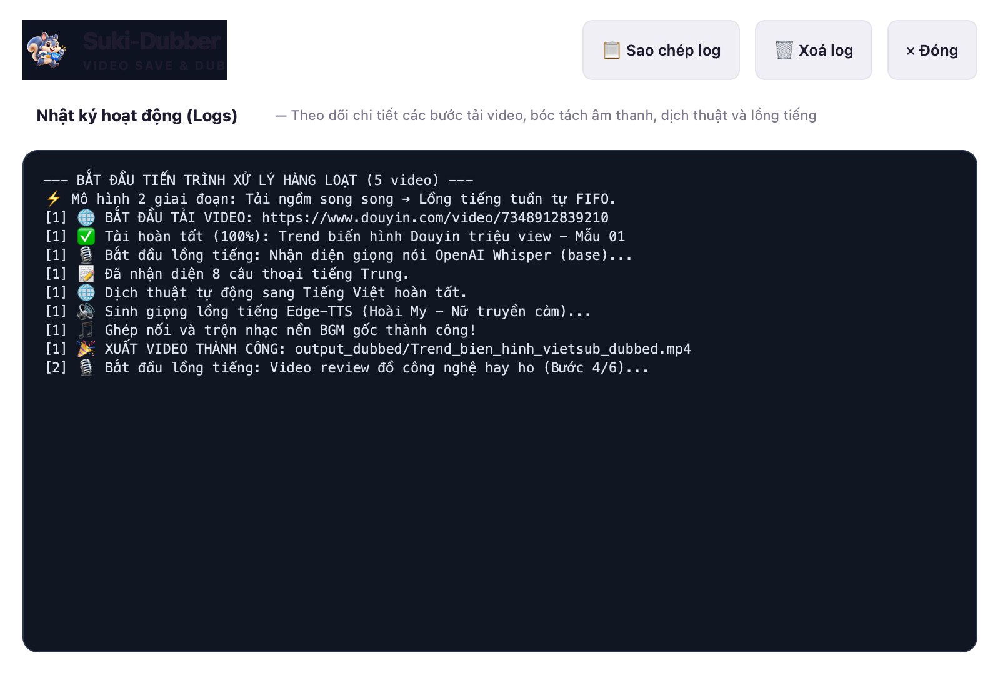

<p align="center">
  
</p>

<h1 align="center">Suki-Dubber</h1>

<p align="center">
  <strong>Giải pháp tự động hoá tải &amp; dịch lồng tiếng video AI đa nền tảng tối ưu (Douyin, TikTok, YouTube, Facebook).</strong>
</p>

<table align="center">
  <tr>
    <td align="center" width="260">
      <br>
      <strong>Suki-Dubber cho Windows</strong><br>
      <sub>64-bit · Bộ cài đặt EXE</sub><br><br>
      <a href="https://github.com/suki-app/suki-dubber-doc/releases/download/v1.0.0/SukiDubber_Setup_v1.0.0.exe"></a>
    </td>
    <td align="center" width="260">
      <br>
      <strong>Suki-Dubber cho Mac</strong><br>
      <sub>M1 · M2 · M3 · M4</sub><br><br>
      <a href="https://github.com/suki-app/suki-dubber-doc/releases/download/v1.0.0/SukiDubber_macOS_v1.0.0_arm64.dmg"></a>
    </td>
    <td align="center" width="260">
      <br>
      <strong>Suki-Dubber cho Mac</strong><br>
      <sub>Intel · x86_64</sub><br><br>
      
    </td>
  </tr>
</table>

<p align="center">
  <a href="README_EN.md">English</a>
  ·
  <a href="https://github.com/suki-app/suki-dubber-doc/releases/latest">Phiên bản mới nhất</a>
  ·
  <a href="#cài-đặt">Hướng dẫn cài đặt</a>
  ·
  <a href="#hướng-dẫn-sử-dụng">Hướng dẫn sử dụng</a>
  ·
  <a href="#khắc-phục-sự-cố">Khắc phục sự cố</a>
</p>

> Phiên bản hiện tại: **Suki-Dubber 1.0.0**. Suki-Dubber là ứng dụng desktop chuyên nghiệp dành cho Windows và macOS, hỗ trợ tự động hoá hoàn toàn quy trình tải video chất lượng cao và chuyển ngữ, lồng tiếng bằng trí tuệ nhân tạo.

---

## Tổng quan

**Suki-Dubber** giải quyết bài toán chuyển ngữ video đa ngôn ngữ (tiếng Trung, tiếng Anh...) sang tiếng Việt một cách tự động, giữ trọn vẹn chất lượng hình ảnh gốc và âm hưởng nhạc nền sống động. Ứng dụng tích hợp các mô hình AI tiên tiến nhất hiện nay (OpenAI Whisper, Microsoft Edge-TTS, Google Gemini) vào một giao diện đồ họa trực quan, hiện đại và dễ sử dụng.

Các tính năng cốt lõi:

- 📥 **Tải video đa nguồn tự động:** Hỗ trợ link Douyin/TikTok (trích xuất không watermark, phân giải gốc), YouTube, Facebook và nhận diện video offline có sẵn trên máy.
- ⚡ **Kiến trúc xử lý 2 giai đoạn (Producer-Consumer):** Tải trước song song qua đa luồng mạng ➔ Lồng tiếng tuần tự theo hàng đợi FIFO qua đa luồng AI an toàn, tối ưu 100% tài nguyên CPU/GPU mà không làm treo máy.
- 🎙️ **Bóc tách lời thoại chính xác (OpenAI Whisper):** Nhận diện từng câu thoại kèm mốc thời gian (*timestamps*) chuẩn xác đến từng mili-giây. Tự động nhận diện thông minh các video chỉ có nhạc nền (`Không có thoại`).
- 🌐 **Dịch thuật đa chế độ:** Hỗ trợ dịch máy miễn phí 100% không giới hạn, hoặc kết nối Google Gemini API để dịch thoát ý, giữ vần điệu cảm xúc và ngữ cảnh giật gân/hài hước.
- 🔊 **Lồng tiếng tự nhiên & Khớp mốc thời gian (Edge-TTS):** Giọng đọc truyền cảm (Hoài My, Nam Minh...), hỗ trợ tùy chỉnh Tông giọng (*Pitch*) và Tốc độ (*Speed*). Thuật toán co giãn âm thanh (*Time-Stretching*) tự động khớp thời lượng câu nói với người nói gốc.
- 🎵 **Giữ nguyên nhạc nền gốc (BGM):** Tách track nhạc nền và trộn đều với giọng lồng tiếng mới theo tỷ lệ âm lượng hoàn hảo.
- 🖥️ **Giao diện làm việc linh hoạt:** Hỗ trợ thu gọn/mở rộng thanh công cụ bên trái để tối đa hoá diện tích bảng danh sách, tích hợp trình xem trước video thành phẩm ngay trong ứng dụng.

<p align="center">
  
</p>

---

## Mục lục

- [Cài đặt](#cài-đặt)
- [Hướng dẫn sử dụng](#hướng-dẫn-sử-dụng)
  - [1. Nạp video vào hệ thống](#1-nạp-video-vào-hệ-thống)
  - [2. Cấu hình dịch thuật & Giọng đọc](#2-cấu-hình-dịch-thuật--giọng-đọc)
  - [3. Kiểm soát tiến trình xử lý hàng loạt](#3-kiểm-soát-tiến-trình-xử-lý-hàng-loạt)
  - [4. Mở rộng không gian làm việc](#4-mở-rộng-không-gian-làm-việc)
  - [5. Xem trước & Mở thư mục thành phẩm](#5-xem-trước--mở-thư-mục-thành-phẩm)
  - [6. Nhật ký hệ thống (Logs)](#6-nhật-ký-hệ-thống-logs)
- [Dữ liệu và quyền riêng tư](#dữ-liệu-và-quyền-riêng-tư)
- [Khắc phục sự cố](#khắc-phục-sự-cố)

---

## Cài đặt

### Yêu cầu hệ thống

| Nền tảng | Phiên bản đề xuất | Gói cài đặt |
|---|---|---|
| Windows | Windows 10/11 64-bit | `SukiDubber_Setup_v1.0.0.exe` |
| macOS Apple Silicon | macOS 12 (Monterey) trở lên | `SukiDubber_macOS_v1.0.0_arm64.dmg` |
| macOS Intel | macOS 12 trở lên | Sắp phát hành |

> Bản cài đặt chính thức đã tích hợp đầy đủ FFmpeg và các thư viện cần thiết. Người dùng không cần tự cài đặt Python hay môi trường lập trình.

### Hướng dẫn cài đặt trên Windows

1. Bấm nút **Tải bản cài cho Windows** ở đầu trang để tải `SukiDubber_Setup_v1.0.0.exe`.
2. Mở file cài đặt vừa tải về và tiến hành cài đặt theo hướng dẫn.
3. Khởi chạy **Suki-Dubber** từ Start Menu hoặc biểu tượng ngoài Desktop.
4. *Lưu ý:* Nếu Windows SmartScreen hiện thông báo bảo vệ, bấm **More info** → chọn **Run anyway**.

### Hướng dẫn cài đặt trên macOS

1. Tải bộ cài `SukiDubber_macOS_v1.0.0_arm64.dmg`.
2. Mở file DMG và kéo biểu tượng **Suki-Dubber.app** vào thư mục **Applications**.
3. Ở lần khởi chạy đầu tiên, chuột phải vào ứng dụng chọn **Open** → bấm **Open**.
4. Nếu macOS hiển thị thông báo ứng dụng từ nhà phát triển chưa được xác thực, vào **Cài đặt hệ thống (System Settings) → Quyền riêng tư & Bảo mật (Privacy & Security)** và chọn **Vẫn mở (Open Anyway)**.

Nếu macOS báo ứng dụng bị cách ly (Gatekeeper), bạn có thể mở Terminal và chạy lệnh sau:
```bash
xattr -dr com.apple.quarantine "/Applications/Suki-Dubber.app"
```

---

## Hướng dẫn sử dụng

### 1. Nạp video vào hệ thống

Suki-Dubber hỗ trợ 2 chế độ nạp video linh hoạt:
- **Tải từ đường link mạng:** Chọn tab *Link Video*, dán danh sách link (Douyin, TikTok, YouTube, Facebook). Hỗ trợ dán nhiều link cùng lúc (mỗi link 1 dòng).
- **Video có sẵn trên máy:** Chọn tab *Folder Video*, bấm *Chọn thư mục* chứa các video `.mp4`, `.mov`, `.mkv` bạn muốn xử lý.

<p align="center">
  
</p>

### 2. Cấu hình dịch thuật & Giọng đọc

Ở thanh công cụ bên trái:
- **Ngôn ngữ gốc:** Chọn ngôn ngữ nguồn của video (Tiếng Trung, Tiếng Anh, hoặc Tự động nhận diện).
- **Giọng đọc AI:** Chọn diễn viên lồng tiếng (ví dụ: *Hoài My* - Nữ truyền cảm, *Nam Minh* - Nam phóng sự/review). Bấm nút loa kế bên để nghe thử mẫu giọng.
- **Tông giọng (Pitch):** Điều chỉnh cao độ giọng nói (kéo sang phải để giọng trong trẻo/trẻ em, kéo sang trái để giọng trầm ấm, dày dặn).
- **Tốc độ đọc (Speed):** Tăng giảm tốc độ đọc theo nhu cầu.
- **Giữ nhạc nền gốc (BGM):** Tích chọn để ứng dụng tự động tách nhạc nền và trộn đều với giọng đọc tiếng Việt mới.
- **Số luồng AI chạy đồng thời:** Tùy chọn 1 đến 4 luồng song song (mặc định khuyến nghị là 2 luồng để đảm bảo máy chạy mượt mà).

<p align="center">
  
</p>

> 💡 **Mẹo:** Trong mục **Cài đặt** (biểu tượng bánh răng góc trên), bạn có thể nhập **Google Gemini API Key** nếu muốn bản dịch được trau chuốt theo phong cách văn học, giật gân hoặc hài hước.

### 3. Kiểm soát tiến trình xử lý hàng loạt

Khi bấm **Bắt đầu xử lý**:
- Cột **TẢI VỀ**: Thể hiện tiến độ tải video từ mạng (hoặc đạt 100% tức thì nếu là video từ máy).
- Cột **LỒNG GIỌNG**: 
  - `Chờ lượt`: Video đang trong hàng đợi chờ luồng AI trống tiếp nhận.
  - `5% - 95%`: Đang trong các bước bóc tách Whisper, dịch thuật, tạo audio Edge-TTS và mix FFmpeg.
  - `100%`: Hoàn thành xuất sắc video thành phẩm.
  - `Không có thoại` *(Màu cam nhạt)*: Nhận diện video chỉ có nhạc nền / hiệu ứng âm thanh, không chứa tiếng người nói.
  - `Lỗi` *(Màu đỏ)*: Sự cố mạng hoặc file hỏng.
- **Nút Refresh thông minh:** Khi một dòng bị lỗi hoặc không có thoại, nút Play sẽ tự động chuyển thành icon **Thử lại (Refresh)** để bạn bấm chạy lại riêng video đó bất cứ lúc nào.

### 4. Mở rộng không gian làm việc

Khi làm việc với danh sách hàng chục video, bạn có thể bấm vào nút **Thu gọn (Sidebar Collapse)** ở góc trái để ẩn toàn bộ panel cài đặt, mở rộng 100% chiều ngang cho bảng tác vụ. Bấm lại nút này để mở rộng cài đặt ra như cũ.

<p align="center">
  
</p>

### 5. Xem trước & Mở thư mục thành phẩm

- Ngay khi một video được tải về hoặc lồng tiếng xong, nút **Thư mục** (mở folder chứa video) và nút **Play** sẽ sáng lên.
- Bấm vào nút **Play** để mở ngay trình phát video độc lập tích hợp sẵn của Suki-Dubber để kiểm tra chất lượng âm thanh và hình ảnh thành phẩm.

<p align="center">
  
</p>

### 6. Nhật ký hệ thống (Logs)

Bấm vào nút **Logs** ở góc trên bên phải để theo dõi trực tiếp chi tiết từng bước mà AI đang xử lý (tách audio, nhận diện từng câu thoại, thời gian đọc, kết quả trộn file...). Bạn cũng có thể bấm *Sao chép Logs* để gửi hỗ trợ khi gặp sự cố.

<p align="center">
  
</p>

---

## Dữ liệu và quyền riêng tư

- **Xử lý Offline / On-Device:** Quá trình nhận diện âm thanh qua Whisper và tổng hợp FFmpeg diễn ra 100% cục bộ trên phần cứng máy tính của bạn.
- **Bảo mật API Key:** Google Gemini API Key của bạn được lưu trữ an toàn trong cấu hình máy cá nhân (`QSettings` / Keychain), không bao giờ gửi về máy chủ bên thứ ba.
- **Không lưu trữ video của người dùng:** Ứng dụng không thu thập, tải lên hay lưu trữ video của bạn trên bất kỳ máy chủ đám mây nào.

---

## Khắc phục sự cố

### 1. Tải video Douyin bị báo lỗi "Quá thời gian tải trang"
- **Nguyên nhân:** Mạng Internet chập chờn hoặc Douyin yêu cầu xác thực captcha IP tại thời điểm đó.
- **Cách xử lý:** Bấm vào nút icon **Refresh** màu xanh ở cột *Tải về* của dòng đó để hệ thống thử tải lại tự động.

### 2. Video hiển thị trạng thái "Không có thoại"
- **Nguyên nhân:** Video là clip B-roll, video thời trang hoặc clip hài ngắn chỉ chèn nhạc nền mà không có lời thoại con người.
- **Giải thích:** Đây là tính năng nhận diện thông minh của Suki-Dubber giúp bạn biết video không cần lồng tiếng, tránh mất thời gian xử lý AI vô ích.

### 3. macOS báo ứng dụng bị hỏng hoặc không mở được
- Mở ứng dụng **Terminal** trên Mac và chạy lệnh:
  ```bash
  xattr -dr com.apple.quarantine "/Applications/Suki-Dubber.app"
  ```
- Sau đó mở lại ứng dụng bình thường.

---

<p align="center">
  Được phát triển với tình yêu bởi đội ngũ <strong>SukiFlow / Suki-Dubber Team</strong> 🐿️
</p>
