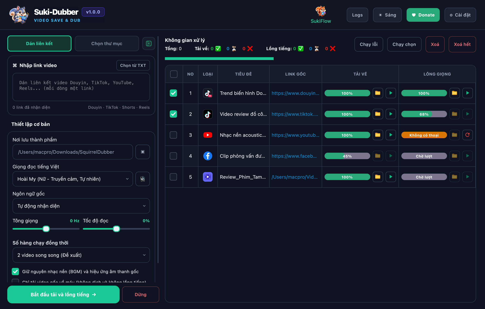
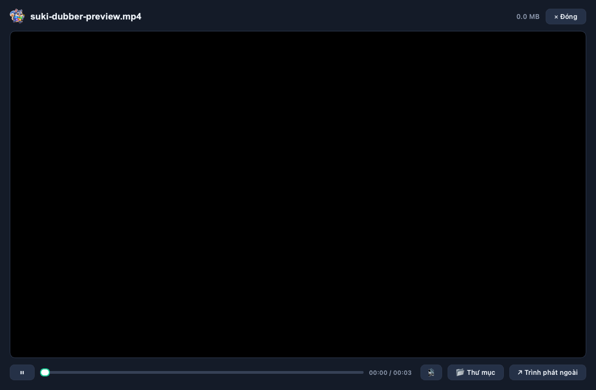

<p align="center">
  
</p>

<h1 align="center">Suki-Dubber</h1>

<p align="center">
  <strong>Automated Multi-Platform AI Video Downloader &amp; Smart Dubbing Solution (Douyin, TikTok, YouTube, Facebook).</strong>
</p>

<table align="center">
  <tr>
    <td align="center" width="260">
      <br>
      <strong>Suki-Dubber for Windows</strong><br>
      <sub>64-bit · EXE Installer</sub><br><br>
      <a href="https://github.com/suki-app/suki-dubber-doc/releases/download/v1.0.0/Suki-Dubber-Setup-v1.0.0.exe"></a>
    </td>
    <td align="center" width="260">
      <br>
      <strong>Suki-Dubber for Mac</strong><br>
      <sub>M1 · M2 · M3 · M4</sub><br><br>
      <a href="https://github.com/suki-app/suki-dubber-doc/releases/download/v1.0.0/SukiDubber_macOS_v1.0.0_arm64.dmg"></a>
    </td>
    <td align="center" width="260">
      <br>
      <strong>Suki-Dubber for Mac</strong><br>
      <sub>Intel · x86_64</sub><br><br>
      
    </td>
  </tr>
</table>

<p align="center">
  <a href="README.md">Tiếng Việt</a>
  ·
  <a href="https://github.com/suki-app/suki-dubber-doc/releases/latest">Latest Release</a>
  ·
  <a href="#installation">Installation Guide</a>
  ·
  <a href="#how-to-use">How to Use</a>
  ·
  <a href="#troubleshooting">Troubleshooting</a>
</p>

> Current version: **Suki-Dubber 1.0.0**. Suki-Dubber is a professional desktop application for Windows and macOS, streamlining automated video extraction, translation, and emotional AI dubbing.

---

## Overview

**Suki-Dubber** automates the end-to-end pipeline of translating foreign videos (Chinese, English...) into Vietnamese with natural emotional voices, while fully preserving original video resolution and background music (BGM).

Core Features:

- 📥 **Multi-Platform Batch Download:** Seamlessly extracts watermark-free videos from Douyin, TikTok, YouTube, Facebook, and supports local offline video files.
- ⚡ **2-Stage Processing Architecture:** Concurrent network downloads ➔ Sequential FIFO queueing for AI tasks to ensure system stability and avoid CPU/RAM overload.
- 🎙️ **Precise Speech-to-Text (OpenAI Whisper):** Detects spoken segments with millisecond-accurate timestamps. Automatically tags music-only videos as `No Speech`.
- 🌐 **Flexible Translation:** Free unlimited machine translation or optional Google Gemini API integration for sensational, humorous, and culturally nuanced dubbing scripts.
- 🔊 **Emotional AI Dubbing & Time-Stretching (Edge-TTS):** Natural expressive voices (Hoài My, Nam Minh...), customizable Pitch & Speed, with automatic audio time-stretching to match original lip sync.
- 🎵 **Original Background Music Preservation (BGM):** Extracts background tracks and mixes them seamlessly with newly generated voice tracks.
- 🖥️ **Ergonomic Workspace:** Collapsible sidebar for wide table view, integrated media player preview, and single-click task retry buttons.

<p align="center">
  
</p>

---

## Installation

### System Requirements

| Platform | Recommended Version | Package |
|---|---|---|
| Windows | Windows 10/11 64-bit | `Suki-Dubber-Setup-v1.0.0.exe` |
| macOS Apple Silicon | macOS 12 (Monterey) or later | `SukiDubber_macOS_v1.0.0_arm64.dmg` |
| macOS Intel | macOS 12 or later | Coming Soon |

### Windows Installation

1. Click **Download for Windows** to get `Suki-Dubber-Setup-v1.0.0.exe`.
2. Run the installer and follow the on-screen steps.
3. Launch **Suki-Dubber** from the Start Menu or Desktop shortcut.
4. *Note:* If Windows SmartScreen prompts a security warning, click **More info** → **Run anyway**.

### macOS Installation

1. Download `SukiDubber_macOS_v1.0.0_arm64.dmg`.
2. Open the DMG and drag **Suki-Dubber.app** to your **Applications** folder.
3. On first launch, right-click the app icon and select **Open** → **Open**.
4. If Gatekeeper blocks the app, open Terminal and run:
   ```bash
   xattr -dr com.apple.quarantine "/Applications/Suki-Dubber.app"
   ```

---

## How to Use

1. **Add Videos:** Paste links (Douyin, TikTok, YouTube, Facebook) or select a local video directory.
2. **Configure Settings:** Choose source language, voice actor (Hoài My / Nam Minh), pitch, speed, and whether to preserve original BGM.
3. **Run Batch Tasks:** Watch real-time 2-stage progress bars (Download ➔ Dubbing).
4. **Expand View:** Click the collapse button on the sidebar to expand table view to full width.
5. **Preview & Export:** Click the Play button on any completed row to watch the dubbed video immediately in the built-in player.

<p align="center">
  
</p>

<p align="center">
  
</p>

---

## Privacy & Security

- **100% On-Device Processing:** Whisper AI transcription and FFmpeg audio mixing run completely offline on your computer.
- **Local Credential Storage:** Gemini API keys are encrypted and stored locally via `QSettings` / Keychain; never sent to third-party servers.

---

<p align="center">
  Crafted with care by <strong>SukiFlow / Suki-Dubber Team</strong> 🐿️
</p>
